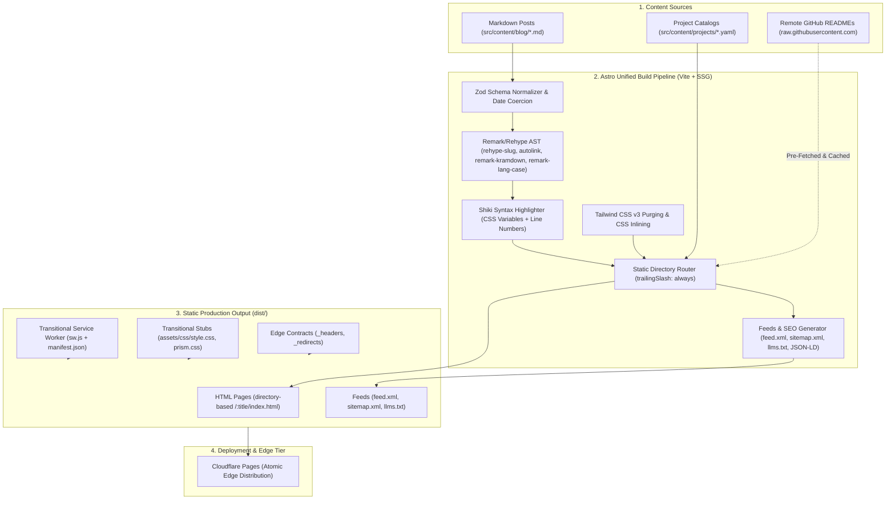

# Astro SSG Migration for ntsd.dev

*   **Author:** ntsd
*   **Status:** Implemented
*   **Date:** 2026-11-06

--------------------------------------------------------------------------------

## Overview

This design document specifies migrating `ntsd.dev` from its hybrid build pipeline (Jekyll 4, Ruby/Bundler, Gulp 4, PostCSS, Express, and Puppeteer headless browser pre-rendering) to a static site generator powered by **Astro** (`output: 'static'`) on a pure Node.js/npm runtime.

The primary objective is to consolidate build tooling onto a single Node/npm runtime, enforce schema validation on frontmatter with Astro Content Collections, rebuild layouts and components as `.astro` files using semantic HTML and Tailwind CSS, and integrate compile-time AI search indexing (`llms.txt`, Schema.org JSON-LD). This transition is bounded by invariants: preserving the verified 100/100 Lighthouse benchmark, ensuring 100% URL and canonical routing parity, maintaining Giscus discussion continuity, and bridging legacy PWA service worker caching without client lockout.

## Problem Statement

The current build pipeline for `ntsd.dev` requires two runtimes (Ruby and Node.js) and multiple orchestration tools:
1. **Multi-Runtime Overhead**: The site requires both Ruby (Bundler, native C extensions for Jekyll) and Node.js (yarn/npm, Babel 6, Gulp), increasing CI setup time (~2–3 minutes) and introducing local environment instability across macOS upgrades.
2. **Headless Browser Pre-Rendering**: To achieve a 100/100 Lighthouse score without client-side JavaScript, the build spins up an Express server on port `6969` and uses headless Chromium (Puppeteer) to execute client-side scripts ([PrismJS](src/js/prism.js), AnchorJS, `wordcloud2.js`) and critical CSS extraction against generated HTML. This process is slow and resource-heavy.
3. **Performance Regression Constraints**: Because the site currently scores 100/100 on Lighthouse, introducing client-side framework JavaScript or external render-blocking stylesheets will cause performance regressions.
4. **Routing and Cache Incompatibility Risks**: Reader comments are powered by Giscus with `pathname` mapping. Any URL normalization discrepancies (such as removing trailing slashes) will disconnect existing comment threads. Furthermore, returning visitors running the existing `cacheFirst` service worker risk cache lockout if asset migration is not explicitly bridged.

## Goals

*   **Single Unified Runtime**: Consolidate the entire build and development workflow onto Node.js (LTS) and npm, removing Ruby, Bundler, Gulp, Express, Babel 6, and Puppeteer.
*   **Zero-JS Baseline**: Produce static HTML/CSS by default (`output: 'static'`) with 0KB runtime framework JavaScript, preserving the 100/100 Lighthouse score across Mobile and Desktop.
*   **100% URL & SEO Parity**: Guarantee identical directory-style permalinks (`/:title/`), blog pagination (`/blog/` and `/blog/page/:num/`), project paths (`/projects/:id/`), and tag/category anchors with trailing slashes, preserving all Giscus discussion threads and search rankings.
*   **Transitional PWA Resilience**: Implement an updated service worker that claims clients immediately, purges legacy cache buckets (`pre-version*`, `runtime-version*`), and provides offline reading.
*   **AI Search Indexing**: Automatically generate `/llms.txt` and Schema.org JSON-LD structured data (`BlogPosting`, `TechArticle`) at compile time.
*   **Template Modernization**: Rebuild templates using clean `.astro` components adhering to semantic HTML, responsive layout, and `@tailwindcss/typography` utilities.
*   **Compile-Time Markdown Processing**: Replace Puppeteer pre-rendering with native build-time compile pipelines: Shiki with CSS variables and line numbering for syntax highlighting, and `rehype-slug` + `rehype-autolink-headings` for section anchors.

## Non-Goals

*   **No Client-Side UI Frameworks**: No introduction of React, Vue, Svelte, or Astro client hydration islands (`client:load`, `client:visible`). All components are static `.astro` templates.
*   **No Server-Side Rendering (SSR)**: The site will not deploy SSR adapters or serverless edge compute functions.
*   **No URL or Slug Restructuring**: Historical post slugs, date associations, and fragment identifiers will not be changed.
*   **No Canvas Word Cloud Simulation**: `wordcloud2.js` canvas coordinate physics will not be replicated in Astro; tag clouds will use accessible, responsive CSS-scaled semantic HTML.
*   **No Standalone Cloudflare Worker Proxy**: Decommission `ntsd-dev-worker` in favor of direct deployment to Cloudflare Pages with standard `_headers` and `_redirects`.
*   **No Speculative Full Corpus Dumps**: Full markdown corpus generation (`/llms-full.txt`) is excluded to maintain strict 1:1 migration scope.

## Critical User Journeys (CUJs)

### CUJ 1: Reader Visits Existing Post via Search Backlink
*   **Given**: A reader clicks an external backlink or Google search result pointing to `https://ntsd.dev/node-stream-pipe-and-transform/`.
*   **When**: The browser requests the page.
*   **Then**: The page returns HTTP 200 with directory-style trailing slash, inlined critical CSS renders without FCP delay, syntax highlighting displays with zero client JS, Giscus loads existing GitHub discussion comments using the exact pathname match, and Lighthouse evaluates to 100 across all four categories.

### CUJ 2: Existing PWA User Opens Site Post-Cutover
*   **Given**: A user has the legacy Jekyll site installed as a PWA on mobile, running the active `src/js/sw.js` with cached HTML and legacy asset paths (`style.css`, `prism.css`).
*   **When**: The user opens the PWA post-deployment.
*   **Then**: The transitional `/sw.js` executes `self.skipWaiting()` and `clients.claim()`, purges legacy `runtime-version*` and `pre-version*` caches from `CacheStorage`, caches new assets, and renders the updated site without blank screens or stale layout assets.

### CUJ 3: Author Writes and Publishes a New Technical Post
*   **Given**: The author creates a new Markdown file in `src/content/blog/`.
*   **When**: The author runs `npm run dev` for live preview and pushes to main for deployment.
*   **Then**: Astro's Content Collection Zod schema validates frontmatter with clear compile-time error reporting, drafts marked `draft: true` preview locally but are excluded from production builds, and Cloudflare Pages compiles the static site in under 30 seconds without headless browser dependencies.

--------------------------------------------------------------------------------

## Proposed Architecture

### 1. System Architecture & Compilation Graph



### 2. Workspace Directory Structure

```text
/
├── .github/workflows/deploy.yml   # Cloudflare Pages / GitHub Actions build & parity test
├── astro.config.mjs               # Astro SSG configuration (trailingSlash: always)
├── tailwind.config.mjs            # Tailwind v3 configuration
├── package.json                   # Consolidated Node dependencies (zero Ruby/Gulp)
├── tsconfig.json                  # TypeScript configuration
├── routes-baseline.json           # Snapshot of legacy production routes for parity test
├── public/
│   ├── _headers                   # Cloudflare security headers & CSP
│   ├── _redirects                 # Edge redirect rules
│   ├── favicon.svg                # Favicon and app icons
│   ├── assets/css/style.css       # 200 OK dummy stub for legacy SW
│   ├── assets/css/prism.css       # 200 OK dummy stub for legacy SW
│   ├── pwa/                       # Migrated from root pwa/ (manifest.json, icons)
│   ├── img/                       # Migrated from root img/ (historical post images)
│   └── sw.js                      # Transitional PWA Service Worker
├── src/
│   ├── content.config.ts          # Zod schemas for blog and projects
│   ├── content/
│   │   ├── blog/                  # 18 historical Markdown posts (migrated from _posts/)
│   │   └── projects/              # Projects ported from _data/*.yaml
│   ├── plugins/
│   │   ├── remark-kramdown.ts     # Remark plugin transforming {: .line-numbers}
│   │   └── remark-lang-case.ts    # Remark plugin normalizing code block language tags
│   ├── components/
│   │   ├── BaseHead.astro         # Meta tags, SEO, DNS preconnects, OpenGraph
│   │   ├── Nav.astro              # Responsive navigation & mobile menu toggle
│   │   ├── Footer.astro           # Footer, copyright, social icons
│   │   ├── ProjectCard.astro      # Grid card component for portfolio projects
│   │   ├── Giscus.astro           # Deferred discussion embed with IntersectionObserver
│   │   ├── TagCloud.astro         # Compile-time CSS-scaled semantic tag cloud
│   │   ├── SchemaOrg.astro        # Structured JSON-LD (BlogPosting, TechArticle)
│   │   └── TOC.astro              # Table of contents extracted from Markdown headings
│   ├── layouts/
│   │   ├── BaseLayout.astro       # Root layout wrapper
│   │   ├── PostLayout.astro       # Article template with header banner and TOC
│   │   └── PageLayout.astro       # Generic page template
│   ├── pages/
│   │   ├── index.astro            # Homepage / landing
│   │   ├── about.astro            # About / bio page
│   │   ├── blog/index.astro       # Blog index (page 1, posts 1..7)
│   │   ├── blog/page/[page].astro # Blog pagination (pages 2..3)
│   │   ├── [...slug].astro        # Dynamic root post router with regex date stripping
│   │   ├── projects/index.astro   # Portfolio catalog
│   │   ├── projects/[id].astro    # Project detail with compiled README rendering
│   │   ├── tags.astro             # Tag aggregator (with #<tag> anchor IDs)
│   │   ├── categories.astro       # Category aggregator (with #<cat> anchor IDs)
│   │   ├── feed.xml.ts            # RSS endpoint (preserving /feed.xml)
│   │   ├── llms.txt.ts            # Machine-readable summary feed
│   │   └── 404.astro              # Static 404 error page
│   └── styles/
│       └── global.css             # Base styles, Tailwind directives, Shiki tokens
└── scripts/
    ├── fetch-readmes.mjs          # Pre-build script fetching and caching remote READMEs
    └── verify-parity.mjs          # Pre-cutover CI verification script comparing against routes-baseline.json
```

### 3. Route & Permalink Parity Matrix

| Route Type | Legacy Jekyll Route | Astro File Mapping | Canonical URL Output |
| :--- | :--- | :--- | :--- |
| **Blog Post** | `/:title/` | `src/pages/[...slug].astro` | `https://ntsd.dev/:title/` |
| **Blog Index (Page 1)** | `/blog/` | `src/pages/blog/index.astro` | `https://ntsd.dev/blog/` |
| **Blog Index (Page 2+)** | `/blog/page/:num/` | `src/pages/blog/page/[page].astro` | `https://ntsd.dev/blog/page/:num/` |
| **Projects Catalog** | `/projects/` | `src/pages/projects/index.astro` | `https://ntsd.dev/projects/` |
| **Project Detail** | `/projects/:id/` | `src/pages/projects/[id].astro` | `https://ntsd.dev/projects/:id/` |
| **Tag Aggregator** | `/tags/#<tag>` | `src/pages/tags.astro` (with `id="<tag>"`) | `https://ntsd.dev/tags/#<tag>` |
| **Category Aggregator** | `/categories/#<cat>` | `src/pages/categories.astro` (with `id="<cat>"`) | `https://ntsd.dev/categories/#<cat>` |
| **RSS Feed** | `/feed.xml` | `src/pages/feed.xml.ts` | `https://ntsd.dev/feed.xml` |
| **Sitemap** | `/sitemap.xml` | `@astrojs/sitemap` | `https://ntsd.dev/sitemap.xml` |
| **AI Discovery** | *New Feature* | `src/pages/llms.txt.ts` | `https://ntsd.dev/llms.txt` |

*Configuration Invariant*: `astro.config.mjs` explicitly sets:
```javascript
export default defineConfig({
  output: 'static',
  trailingSlash: 'always',
  build: {
    format: 'directory',
    inlineStylesheets: 'always' // Inlines CSS directly to guarantee zero FCP roundtrip delays
  }
});
```

*Post Slug Resolution*: In `src/pages/[...slug].astro`, post slugs are generated by stripping the Jekyll date prefix:
```typescript
const RESERVED_SLUGS = new Set([
  'about', 'blog', 'projects', 'tags', 'categories', 'feed.xml', 'llms.txt', 'sw.js', '404'
]);

export async function getStaticPaths() {
  const posts = await getCollection('blog');
  return posts.map((post) => {
    const slug = post.id.replace(/^\d{4}-\d{2}-\d{2}-/, '');
    if (RESERVED_SLUGS.has(slug)) {
      throw new Error(`Collision: post slug "${slug}" conflicts with top-level route.`);
    }
    return { params: { slug }, props: { post } };
  });
}
```

### 4. Content Layer & Frontmatter Schema Normalization

The Astro Content Collection schema (`src/content.config.ts`) normalizes historical frontmatter variance without requiring mass edits:

*   **Date Normalization**: Coerces single-digit dates (`2024-7-29` -> `2024-07-29`) and trailing timestamps to valid `Date` objects.
*   **Array Coercion**: Coerces single string values into arrays for `tags` and `categories`.
*   **Key Mapping**: Maps legacy `header-img` to `headerImg: z.string().optional()`.
*   **Draft Filtering**: Excludes posts with `published: false` from production builds while keeping them visible in `astro dev`.
*   **Project Catalogs**: Ingests both `_data/projects.yaml` and `_data/featured-projects.yaml`, preserving all featured project pages (`zero-share`, `cross-clipboard`, `tools`, `lisuify`).

### 5. Build-Time AST Markdown Pipeline

The Puppeteer pre-render step is replaced with compile-time plugins:

1. **Syntax Highlighting & Line Numbers**:
   - Built-in Shiki configured with `css-variables` theme.
   - Configured with `@shikijs/transformers` `transformerLineNumbers()` to preserve line numbers.
   - `src/plugins/remark-lang-case.ts` normalizes casing on language tags (`Python` -> `python`, `c++` -> `cpp`).
2. **Section Heading Anchors**:
   - `rehype-slug` generates heading IDs.
   - `rehype-autolink-headings` injects anchor `#` links matching legacy AnchorJS behavior without client JavaScript.
3. **Kramdown Attribute Transformation**:
   - `src/plugins/remark-kramdown.ts` intercepts Kramdown inline attribute lists (`{: .line-numbers}`) and attaches them as code block meta properties rather than leaking raw text into output HTML.
4. **Accessible Tag Cloud (`TagCloud.astro`)**:
   - Computes tag frequency distribution across all posts at build time.
   - Renders semantic HTML tag chips with CSS `font-size` scaling between `0.875rem` and `2rem`, eliminating canvas physics.

### 6. Remote Content Ingestion & Rate Limit Resilience

External READMEs for portfolio projects are fetched and compiled using a decoupled architecture:
1. **Pre-Build Fetch Script (`scripts/fetch-readmes.mjs`)**:
   - Runs prior to `astro build` during CI.
   - Reads project lists and fetches raw markdown files from `raw.githubusercontent.com`.
   - Passes `GITHUB_TOKEN` if present in the environment to avoid rate limits.
   - Stores fetched markdown files in `.cache/readmes/<id>.md`.
   - Fails the build if any remote fetch fails and no cached copy is available.
2. **Runtime Compilation in `src/pages/projects/[id].astro`**:
   - Reads the cached markdown from `.cache/readmes/<id>.md`.
   - Compiles markdown to HTML using `marked.parse(markdown)`.
   - Injects the compiled HTML into the project layout template with styling and syntax highlighting.

### 7. Transitional PWA Service Worker & Cache Invalidation

To resolve client cache transitions without lockout, `public/sw.js` implements a transitional lifecycle bridge:

*   **Install Phase**: Calls `self.skipWaiting()` to take control immediately.
*   **Activate Phase**: Iterates through `caches.keys()`, explicitly deleting legacy buckets (`pre-version*`, `runtime-version*`), and calls `clients.claim()`.
*   **Fetch Phase**:
    *   For navigation requests: Employs network-first strategy, falling back to cached HTML if offline.
    *   For static assets: Employs stale-while-revalidate, serving from cache while updating cache in the background via `cache.put()`.
*   **Legacy Stubs**: Dummy 200 OK files at `public/assets/css/style.css` and `public/assets/css/prism.css` ensure legacy workers performing background updates do not abort with 404 errors.

### 8. Edge Configuration & Decommissioning Cloudflare Worker

*   Decommission `ntsd-dev-worker` completely.
*   Deploy Astro directly to **Cloudflare Pages**.
*   `public/_headers`: Enforces strict CSP, HSTS preloading, and 1-year cache control headers for immutable static assets.
*   `public/_redirects`: Manages edge redirect rules.

--------------------------------------------------------------------------------

## Risks & Mitigations

| Risk | Likelihood | Impact | Failure Mode | Mitigation Strategy |
| :--- | :---: | :---: | :--- | :--- |
| **Giscus Discussion Disconnection** | Low | Critical | Trailing slash omissions or slug case shifts cause Giscus `pathname` mapping to query empty threads, orphaning comments. | Lock `trailingSlash: 'always'` and `build.format: 'directory'`. Run automated pre-cutover CI audit asserting 100% path parity against `routes-baseline.json`. |
| **PWA Client Cache Lockout** | Medium | Critical | Legacy `cacheFirst` worker serves stale cached Jekyll HTML looking for deleted asset files, causing blank screens. | Replacement `sw.js` executes `skipWaiting()` and `clients.claim()` immediately, purges `pre-version*` caches, and serves 200 OK dummy stubs for `style.css` and `prism.css`. |
| **CI Remote Ingestion Rate Limiting** | Medium | High | Unauthenticated requests from cloud runner IPs to GitHub trigger HTTP 403, failing project page builds. | Decouple fetching to `scripts/fetch-readmes.mjs` with `GITHUB_TOKEN` authentication and persistent CI caching. |
| **Lighthouse Score Degradation** | Medium | High | External render-blocking stylesheets or client runtime JS drop scores below 100. | Enforce `build.inlineStylesheets: 'always'` to eliminate CSS roundtrips. Zero-JS framework budget. Enforce strict LHCI assertion thresholds in CI. |
| **Syntax Highlighting Line Number Loss** | High | Low | Stripping Kramdown attributes causes loss of code block line numbers across technical tutorials. | Use `remark-kramdown.ts` to convert `{: .line-numbers}` to code block metadata, paired with Shiki's line number transformer. |

--------------------------------------------------------------------------------

## Alternatives Considered

### Alternative A: In-Place Jekyll Modernization

*   **Description**: Keep Jekyll 4 and Ruby/Bundler, but remove Gulp and Puppeteer by migrating syntax highlighting to built-in Rouge and adding Liquid templates for `llms.txt` and Schema.org JSON-LD.
*   **Pros**: Zero risk of routing regressions; zero template rewrite effort; guaranteed 100/100 Lighthouse score.
*   **Cons**: Preserves the dual Ruby + Node dependency chain on local environments and CI; leaves legacy Babel/Gulp tech debt; lacks compile-time frontmatter schema validation (Zod); does not provide component-based template authoring.
*   **Rejection Rationale**: Retaining Jekyll preserves the dual Ruby/Node runtime dependency and lacks compile-time schema validation and modern component encapsulation.

### Alternative B: Complete Deprecation of PWA Service Worker

*   **Description**: Drop `sw.js` entirely, removing offline caching and relying exclusively on Cloudflare edge CDN HTTP caching headers.
*   **Pros**: Eliminates service worker invalidation complexity; reduces client runtime logic; simplifies deployment caching.
*   **Cons**: Breaks offline reading for existing mobile and desktop PWA users; still requires deploying an unregistration worker to evict active client workers.
*   **Rejection Rationale**: Dropping the service worker breaks offline reading, violating the project requirement for offline availability.

### Alternative C: Static Generation via Next.js Static Export or Hugo

*   **Description**: Migrate to Next.js using `output: 'export'` for React components, or migrate to Go-based Hugo for build speed.
*   **Pros**: Next.js provides React ecosystem integration; Hugo provides sub-second static generation speeds.
*   **Cons**: Next.js ships client-side React hydration runtime JavaScript bundles by default, directly degrading Total Blocking Time (TBT) and forfeiting the 100/100 Lighthouse requirement. Hugo introduces Go template syntax friction and lacks TypeScript component authoring and frontmatter typing.
*   **Rejection Rationale**: Next.js static export includes client-side React hydration runtime bundles by default, failing the zero-JS budget and increasing Total Blocking Time. Hugo lacks component-level TypeScript encapsulation and frontmatter typing.

### Alternative D: Retaining Standalone Cloudflare Worker (`ntsd-dev-worker`)

*   **Description**: Deploy Astro static files to static storage while keeping `ntsd-dev-worker` as an active proxy for edge caching.
*   **Pros**: Reuses existing Cloudflare KV cache-busting logic.
*   **Cons**: Introduces dual-routing complexity, double edge execution hops, and divergent header management. Cloudflare Pages already provides atomic global deployments and automated edge cache invalidation natively.
*   **Rejection Rationale**: Maintaining a standalone worker proxy introduces redundant edge execution hops and dual-configuration maintenance without functional benefit over native Cloudflare Pages.

--------------------------------------------------------------------------------

## Non-Functional Requirements

### Performance & Latency
*   **Lighthouse Target**: Maintain verified 100/100 scores across all 4 categories (Performance, Accessibility, Best Practices, SEO) on both Mobile and Desktop audit profiles.
*   **Zero-JS Budget**: 0KB framework runtime JavaScript loaded by default. Only deferred third-party scripts (Giscus comments, Google Analytics) and minimal unbundled vanilla scripts (mobile drawer toggle) are permitted.
*   **CSS Inlining**: Global stylesheets must be inlined into HTML `<head>` (`build.inlineStylesheets: 'always'`) to eliminate render-blocking stylesheet network roundtrips.

### Security & Privacy
*   **Strict Content Security Policy (CSP)**: Maintain strict headers via `public/_headers`:
    `default-src 'none'; script-src 'self' 'unsafe-inline' giscus.app *.googletagmanager.com *.google-analytics.com; style-src 'self' 'unsafe-inline'; img-src 'self' data: https:; font-src 'self'; connect-src 'self' *.google-analytics.com https://api.github.com; base-uri 'none'; form-action 'none'; frame-src giscus.app;`
*   **HTTPS & HSTS**: Enforce HSTS preloading with `max-age=31536000; includeSubDomains; preload`.

### Rollout & Rollback Strategy
*   **Dual-Branch Staging**: Implement migration on `feat/astro-migration`. The legacy Jekyll branch remains deployed until pre-cutover parity verification passes.
*   **Atomic Edge Cutover**: Deploy directly to Cloudflare Pages.
*   **Immediate Rollback Plan**: If post-launch 404s or client cache issues arise, revert Cloudflare Pages build command back to the legacy Jekyll workflow and issue a Cloudflare edge cache purge. The transitional `sw.js` ensures returning visitors refresh cleanly.

--------------------------------------------------------------------------------

## Detailed Implementation Plan

The implementation is executed in **5 sequential phases**, each gated by testable checkpoints.

### Phase 1: Toolchain & Build Configuration Setup

*   **Goal**: Initialize the Node/Astro development environment and configure build invariants.
*   **Files Modified / Created**:
    1. `package.json` (**Modify**): Remove Gulp, Puppeteer, Babel, and Express dependencies. Add `astro` (v4/v5), `@astrojs/tailwind`, `@astrojs/sitemap`, `@astrojs/rss`, `tailwindcss` (v3), `@tailwindcss/typography`, `typescript`, `marked`, `@shikijs/transformers`, `unist-util-visit`, and `schema-dts`. Configure scripts: `"dev": "astro dev"`, `"build": "node scripts/fetch-readmes.mjs && astro build"`, `"preview": "astro preview"`, `"test:parity": "node scripts/verify-parity.mjs"`.
    2. `tsconfig.json` (**Create**): Extend `astro/tsconfigs/strict`.
    3. `tailwind.config.mjs` (**Create**): Configure Tailwind v3 purging `src/**/*.{astro,html,js,ts,md}` and loading `@tailwindcss/typography`.
    4. `astro.config.mjs` (**Create**): Set `output: 'static'`, `trailingSlash: 'always'`, `build: { format: 'directory', inlineStylesheets: 'always' }`, Shiki syntax highlighting with CSS variables, `rehype-slug`, `rehype-autolink-headings`, and `@astrojs/sitemap`.
*   **Checkpoint**: Run `npm install && npx astro info`. Configuration initializes without errors.

### Phase 2: Design System, Base Layouts & Shared Components

*   **Goal**: Build reusable static `.astro` templates and global CSS tokens.
*   **Files Created**:
    1. `src/styles/global.css`: Tailwind directives, typography styling, and Shiki CSS variable tokens matching legacy Tomorrow Night palette.
    2. `src/components/BaseHead.astro`: Meta tags, canonical links, preconnect hints, and OpenGraph headers.
    3. `src/components/Nav.astro`: Semantic navigation with vanilla JavaScript mobile drawer toggle.
    4. `src/components/Footer.astro`: Semantic footer with copyright and social links.
    5. `src/components/ProjectCard.astro`: Portfolio project card with GitHub star metadata.
    6. `src/components/Giscus.astro`: Client discussion embed deferred via `IntersectionObserver`.
    7. `src/components/TagCloud.astro`: Build-time CSS-scaled semantic tag cloud replacing canvas `wordcloud2.js`.
    8. `src/components/SchemaOrg.astro`: Injects Schema.org `BlogPosting` and `TechArticle` JSON-LD blocks.
    9. `src/components/TOC.astro`: Build-time table of contents extracted from Markdown AST headings.
    10. `src/layouts/BaseLayout.astro`, `PostLayout.astro`, `PageLayout.astro`.
*   **Checkpoint**: Create a dummy test page; verify rendering in browser with zero JavaScript bundles emitted.

### Phase 3: Content Layer, Remark Plugins & Data Migration

*   **Goal**: Migrate Markdown articles and project catalogs with strict type validation.
*   **Files Modified / Created**:
    1. `src/plugins/remark-kramdown.ts` (**Create**): Remark AST plugin transforming `{: .line-numbers}` into code block metadata.
    2. `src/plugins/remark-lang-case.ts` (**Create**): Remark AST plugin normalizing code fence language identifiers (`Python` -> `python`, `c++` -> `cpp`).
    3. `src/content.config.ts` (**Create**): Zod schemas for `blog` and `projects` collections. Implements date coercion, array coercion, and draft filtering.
    4. `src/content/blog/` (**Move & Modify**): Move 18 Markdown posts from `_posts/` to `src/content/blog/`.
    5. `src/content/projects/` (**Create**): Ingest project catalog data from `_data/projects.yaml` and `_data/featured-projects.yaml`.
    6. `scripts/fetch-readmes.mjs` (**Create**): Pre-build script fetching remote GitHub READMEs with `GITHUB_TOKEN` support, caching to `.cache/readmes/`.
*   **Checkpoint**: Run `npx astro sync`. All 18 posts and project entries parse successfully with zero Zod validation errors.

### Phase 4: Dynamic Routing, Aggregators, Feeds & Edge Rules

*   **Goal**: Wire directory-based routes, taxonomies, syndication feeds, and edge contracts.
*   **Files Created**:
    1. `src/pages/index.astro`, `about.astro`, `404.astro`.
    2. `src/pages/blog/index.astro`: Blog index page 1 (posts 1..7).
    3. `src/pages/blog/page/[page].astro`: Blog pagination dynamic route for pages 2..3.
    4. `src/pages/[...slug].astro`: Dynamic post router with regex date stripping and reserved slug collision assertions.
    5. `src/pages/projects/index.astro` and `src/pages/projects/[id].astro` (rendering compiled READMEs via `marked.parse()`).
    6. `src/pages/tags.astro` and `src/pages/categories.astro` (with `#<tag>` and `#<category>` anchor IDs).
    7. `src/pages/feed.xml.ts` and `src/pages/llms.txt.ts`.
    8. `public/_headers` and `public/_redirects`.
*   **Checkpoint**: Run `npm run build`. Verify directory output structure in `dist/` matching all canonical URLs.

### Phase 5: Transitional Assets, Verification & Legacy Decommissioning

*   **Goal**: Deploy transitional service worker, run parity verification, and remove legacy files.
*   **Files Created / Decommissioned**:
    1. `routes-baseline.json` (**Create**): Snapshot of all 18 article URLs, pagination paths, project detail routes, and anchor IDs from production `ntsd.dev`.
    2. `public/assets/css/style.css` & `public/assets/css/prism.css` (**Create**): 200 OK dummy stubs.
    3. `public/sw.js` (**Create**): Transitional service worker with `skipWaiting()`, legacy cache cleanup, and runtime caching.
    4. Move `img/` to `public/img/` and `pwa/` to `public/pwa/`.
    5. `scripts/verify-parity.mjs` (**Create**): Automated test script asserting 100% path coverage between `dist/` and `routes-baseline.json`.
    6. `.github/workflows/deploy.yml` (**Create**): CI workflow running build, parity test, LHCI assertions, and Cloudflare Pages deployment.
    7. **Delete Legacy Files**: Remove `Gemfile`, `Gemfile.lock`, `_config.yml`, `gulpfile.mjs`, `ntsd-dev-worker/`, `_plugins/`, `_layouts/`, `_includes/`, `pages/`, and root `index.html`.
*   **Checkpoint**: Run `npm run test:parity` and `npx lhci autorun`. All parity assertions pass with 100/100 Lighthouse scores across all categories.

--------------------------------------------------------------------------------

## Verification Plan

### 1. Build Verification
*   Execute `npm run build` on Node.js 20+ LTS.
*   Assert build exits with code 0 in under 30 seconds.
*   Verify output directory `dist/` contains valid directory-based HTML structures (`/:title/index.html`, `/blog/page/2/index.html`).

### 2. URL & Canonical Parity Automated Audit
*   Run `node scripts/verify-parity.mjs`.
*   The script validates `dist/` against `routes-baseline.json` and asserts:
    1. 100% path coverage: Every historical URL resolves to a corresponding `index.html` in `dist/`.
    2. Directory-style trailing slashes present on all canonical navigation links.
    3. Exact match on `<link rel="canonical">` hrefs.
    4. Exact match on `<meta property="og:url">`.
    5. Fragment anchor verification: Every `#<tag>` and `#<category>` anchor targets an existing DOM `id`.

### 3. Broken Link & Anchor Audit
*   Serve `dist/` locally via `npx astro preview --port 4321`.
*   Execute `npx linkinator http://localhost:4321/ --recurse`.
*   Verify zero internal 404s or broken heading fragment anchors across all 18 articles.

### 4. Automated Lighthouse CI (LHCI) Verification
*   Execute `npx lhci autorun` against local preview server.
*   Assert 100/100 thresholds across Performance, Accessibility, Best Practices, and SEO for both Mobile and Desktop profiles.
*   Assert First Contentful Paint (FCP) < 0.6s and Total Blocking Time (TBT) = 0ms.

### 5. PWA & Service Worker Lifecycle Verification
*   In Chrome DevTools, load `https://ntsd.dev` to register legacy `sw.js`.
*   Serve local Astro build on the same origin (`npm run preview`).
*   Verify in DevTools Application tab:
    1. New `sw.js` activates immediately (`skipWaiting` succeeds).
    2. All legacy `pre-version*` and `runtime-version*` cache buckets are deleted.
    3. Dummy stubs for `style.css` and `prism.css` return HTTP 200 without network aborts.
    4. Disconnect network (offline mode) and verify previously visited pages load successfully.

### 6. Giscus Discussion Continuity Check
*   Sample high-traffic articles with existing discussion threads (`node-stream-pipe-and-transform` and `postgresql-index-types`).
*   Confirm Giscus iframe loads and successfully queries GitHub Discussions using the exact `location.pathname`.
*   Confirm existing comments and reactions display without error.

--------------------------------------------------------------------------------

*Drafted with EGM*
